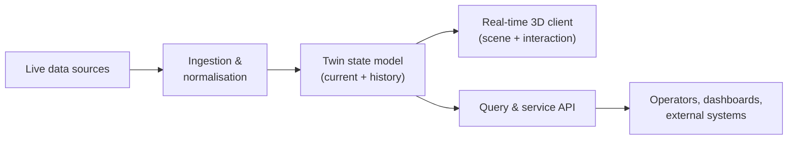

# Digital Twin Platform — 0 to 1

**A real-time digital twin product taken from zero to shipped versions**
Technical architecture · team building · delivery

> **Documentation-only repository.** The production code, data and client assets are proprietary.
> This page describes my role, the architecture approach and the delivery practices — no private
> source, models or customer data are included.

## At a glance

| | |
| --- | --- |
| **Role** | CTO — technical strategy, architecture, engineering leadership |
| **Period** | 2023 — present |
| **Company** | r2corenext |
| **Scope** | 0 → 1 product, then multiple shipped versions |
| **Team** | Built and led the engineering team behind the product |

## Context

The company decided to build a **digital twin product** — a real-time 3D representation of a
physical system, kept in sync with live data — as a new line of business rather than a one-off
project. As CTO I owned the technical plan end to end: what to build first, what to defer, who to
hire, and how to keep delivery predictable while the customer-facing scope kept moving.

## What I owned

- **Product and architecture from 0** — turned the business goal into a technical roadmap and a
  first architecture that could survive the second and third customer versions.
- **Hiring and growing the team** — ran the interview loop and onboarded engineers across the
  client, data and service layers.
- **Delivery** — multiple versions shipped on schedule; planned scope per version and protected
  the release cadence.
- **Hard problems and forward-looking work** — resolved cross-layer technical blockers and
  evaluated new techniques before they became roadmap commitments.
- **Process and people** — built a development process that fitted the team, mentored engineers
  individually, and kept technical knowledge in the team rather than in a few heads.

## Architecture at a high level

A simplified view of a real-time twin system — the twin is only useful if the data is current,
so the data path and the rendering path have to be designed together:

Why this shape:

- **Separate the data path from the rendering path** — live data arrives at a different rate and
  reliability than the frame budget allows, so ingestion and visualisation scale independently.
- **State model as the contract** — client and API read from one canonical twin state instead of
  re-deriving meaning from raw feeds; this keeps every consumer consistent as sources change.
- **History is a first-class requirement** — operators need to compare "now" with "before", so
  the state layer stores time, not just current values.
- **Build the product around one concrete customer** — the first version stayed narrow so it could
  actually ship; generality was added only where a real second use case demanded it.

## Engineering leadership notes

- **A 0 → 1 team needs fewer, clearer interfaces.** Early versions shipped faster when the contract
  between data layer and 3D client was written down and owned, instead of negotiated per feature.
- **Version cadence beats grand plans.** Shipping a smaller release on time kept the customer
  feedback loop alive and exposed scope risks early.
- **Mentoring is a delivery mechanism.** The engineers who grew fastest took ownership of a layer
  and its on-call questions; that is what made multiple parallel versions possible.

## Decision records

The architecture decisions behind this case study are written up as ADRs in
[`docs/adr`](docs/adr): separating the live-data path from the rendering path, making the twin
state model the contract, and scoping the first version around one concrete customer. Each records
the context, the decision, the trade-offs and the alternatives that were rejected.

## Status

The product is developed and operated by the company; this repository is a case study and is not
maintained as software.
